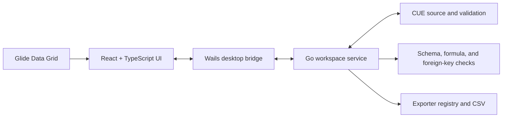

# Datapack Editor

[中文说明](README_zh.md)

**中文入门工程：[《云岚纪》16表/1002行 RPG 配表实战](docs/examples/yunlan-rpg/README.md)** — English field IDs with Chinese display names, localization, gameplay relationships, formulas and guided editing.

Datapack is a desktop editor for structured game data. It combines a spreadsheet-like editing experience with CUE-backed schemas, validation, references, formulas, and text source files that work well with Git.

It is intended to replace workflows built around spreadsheets, manual export scripts, and several disconnected copies of the same data. Designers can edit data in a familiar grid while the project keeps its structure, constraints, relationships, and export settings alongside the data itself.

## What You Can Do

- Create, open, and save `.dtproj` data projects.
- Organize related tables with logical namespaces.
- Edit strings, integers, numbers, booleans, enums, arrays, and flat structures.
- Define reusable public Schemas and table-local Schemas.
- Apply types, defaults, ranges, patterns, enums, and reusable constraints to columns.
- Connect tables with scalar or array foreign keys.
- Navigate from foreign keys, formulas, and Schema references to their targets.
- Use same-row and same-table cross-row formulas.
- Add comments to individual cells.
- Inspect compilation, Schema, formula, and foreign-key diagnostics at the relevant cell.
- Rename referenced rows, tables, columns, and Schema definitions safely.
- Undo and redo source-backed editing operations.
- Configure project-level and table-level CSV export.
- Switch between automatic and manual compilation, Chinese and English, and light or dark themes.

Typical projects include item, character, skill, effect, monster, drop, quest, economy, and balance data. Datapack is most useful when data must be reviewed in Git, validated before release, and kept consistent across related tables.

## Current Scope

This is the first usable release, with deliberately narrow boundaries:

- Datapack edits its own restricted CUE project format; it is not a general-purpose CUE editor.
- CSV is currently the built-in export format.
- Formulas can reference the current row and other rows in the same logical table. They cannot query arbitrary fields across tables.
- Foreign keys provide validation and navigation, not joins or spreadsheet lookup functions.
- Arrays and structures must remain flat. Arbitrarily nested data is not supported by the grid editor.
- There is currently no installer, automatic updater, or operating-system file association.
- Linux is the primary tested desktop environment for the current binary build.

## Run the Binary

Datapack currently ships as a standalone executable rather than an installer. Place the binary anywhere you can run programs from.

On Linux:

```bash
chmod +x datapack
./datapack
```

The Linux build requires GTK 3 and WebKitGTK 4.1 runtime libraries. The exact package names depend on your distribution.

Datapack projects are ordinary directories chosen by you and are independent of the executable location. User-level settings and logs are written under the operating system's user configuration directory. On Linux, the default location is:

```text
~/.config/datapack/
```

## Quick Start

1. Start the `datapack` executable.
2. Choose **File > New project**, or open an existing `.dtproj` file.
3. Open a table or Schema from the project tree.
4. Edit data in the grid and resolve any diagnostics shown by the editor.
5. Configure project export selection and table export columns.
6. Compile the project, then export it.
7. Read generated CSV files from the project's configured `exports/` directory.

For a complete project to explore, open:

```text
docs/examples/skyharbor-content/skyharbor-content.dtproj
```

## Tutorial

The Skyharbor learning project demonstrates the complete editing workflow, including public and local Schemas, constraints, arrays, structures, foreign keys, formulas, comments, diagnostics, navigation, compilation, export, and Undo/Redo.

- [Skyharbor tutorial](docs/examples/skyharbor-content/README.md)
- [Skyharbor 中文教程](docs/examples/skyharbor-content/README_zh.md)

## How Datapack Differs from Excel

Excel and similar spreadsheet applications treat a workbook as a flexible grid. A cell may contain almost anything, and structure is usually expressed through conventions, formulas, validation rules, or external scripts. That flexibility is valuable for analysis, but it can make a large production data set difficult to validate and refactor consistently.

Datapack starts from a different model:

- A project contains explicitly named tables, shared rules, relationships, and export configuration.
- Every table has a declared row structure. Every row is checked against that structure.
- A column is a typed field, not an arbitrary collection of unrelated cells.
- Arrays and structures remain typed values in one cell instead of being spread across ad hoc columns.
- Foreign keys are explicit project relationships, so references can be validated, navigated, renamed, and protected from unsafe deletion.
- Formula results are derived previews and export values; they are not silently copied into source rows.
- Source files are formatted text intended for version control. CSV files are generated outputs, not the authoritative editable source.

The interface resembles a spreadsheet because grids are efficient for editing records. The underlying model is closer to a small typed database and build system: data has a contract, edits are structural operations, and export is allowed only after project validation.

### What Is a Schema?

A Schema is the contract that describes valid data. It answers questions such as:

- Is this field a string, integer, number, boolean, enum, array, or structure?
- Is the value nullable?
- What default should be used when a value is empty?
- Must a number stay within a range?
- Must a string match a naming pattern or be non-empty?
- Which values are allowed by an enum?
- What fields belong to a structure?

Each table has a `#Row` Schema that defines its columns. Datapack also supports two forms of reusable named Schema:

- **Public Schemas** are shared across tables, such as a project-wide game ID format, rarity enum, or non-negative constraint.
- **Local Schemas** belong to one table, such as a position structure or a table-specific level constraint.

Named Schemas are classified as either a complete **type** or a reusable **constraint**. A type supplies the base shape of a value; a constraint narrows an existing compatible type. This distinction prevents ambiguous combinations and lets the editor present structured controls instead of requiring users to write CUE expressions directly.

### Source Expressions and Display Values

A cell's source expression and its displayed value are related but not always identical. A string is stored as a valid CUE string expression, while the grid displays its text. A formula is stored in `_tool.formulas`, while the grid displays its computed result. Arrays and structures are stored as typed CUE values and edited through dedicated controls.

This separation is why clearing, pasting, formula editing, and validation behave differently from an untyped spreadsheet. The editor preserves valid source rather than treating every cell as plain text.

## Design Principles

### Text Source Is the Authority

Table `.cue` files are the maintained source of truth. They are readable, reviewable, and suitable for Git diffs and merges. Generated CSV files never overwrite source tables.

### Rules Live with Data

A table source keeps its responsibilities in explicit sections:

- `#Row` defines the final row structure and validation rules.
- `rows` stores manually entered values.
- `_tool` stores table identity, foreign keys, and formulas.
- `_editor` stores presentation metadata and cell comments.
- `_export` stores export format and column configuration.

### Spreadsheet Editing Without Giving Up Types

The grid provides efficient record editing, but writes are always checked against the table Schema. Invalid data produces a diagnostic at its table, row, and column instead of silently entering an export.

### Refactoring Must Preserve References

Rows, tables, columns, and Schema definitions participate in project-wide relationships. Datapack updates known references during rename operations and blocks deletion when a target is still in use.

### Export Is a Build Step

Automatic compilation gives quick feedback, while manual compilation supports deliberate editing sessions. Regardless of mode, export performs a complete project compile. Tables excluded from output selection still participate in validation.

More detailed format and design documentation:

- [Project design](docs/design.md)
- [`.dtproj` format](docs/dtproj-format-v1.md)
- [Restricted CUE Schema format](docs/restricted-cue-schema-v1.md)
- [Editor settings format](docs/editor-settings-format-v1.md)

## Architecture



- **React and TypeScript** implement the application menus, project tree, table and Schema editors, settings, and diagnostics.
- **Glide Data Grid** provides the high-performance table canvas and cell interactions.
- **Wails** hosts the desktop window and exposes the Go application API to the frontend.
- **The Go workspace service** owns project lifecycle, safe source edits, Undo/Redo, compilation state, semantic navigation, and export orchestration.
- **CUE** provides data shapes, constraints, defaults, source formatting, and final-value validation.
- **Schema, formula, and foreign-key services** build project-wide indexes and diagnostics that are not expressible as isolated cell validation.
- **The exporter registry** discovers available formats and dispatches validated tables to the configured exporter. CSV is the current built-in implementation.

The main edit pipeline is:

```text
user edit
  -> safe CUE AST update
  -> refresh project tree and semantic indexes
  -> evaluate formulas
  -> validate CUE, Schemas, and foreign keys
  -> update grid preview and diagnostics
  -> full compile before export
  -> generated CSV
```

## Build from Source

Building is only necessary for contributors or users who do not have a prebuilt binary.

Required toolchain:

- Go 1.25 or newer
- Wails CLI 2.13
- Node.js 20 or newer and npm
- Linux build dependencies: a C compiler, `pkg-config`, GTK 3 development files, and WebKitGTK 4.1 development files

The CUE Go API and other Go dependencies are pinned in `go.mod`. Frontend dependencies are pinned by the npm lockfile.

Common commands:

```bash
./scripts/dev.sh
./scripts/build.sh
go test ./...
npm --prefix frontend run typecheck
npm --prefix frontend run test:e2e
```

The production binary is written to:

```text
build/bin/datapack
```

The Linux build scripts use the Wails `webkit2_41` build tag.

## Acknowledgements

Datapack is built with the work of these open-source projects:

- [CUE](https://cuelang.org/) for data structure, constraints, and validation.
- [Wails](https://wails.io/) for the Go and web-frontend desktop application framework.
- [Go](https://go.dev/) for the core project, source editing, compilation, and export services.
- [React](https://react.dev/) for the application user interface.
- [Glide Data Grid](https://grid.glideapps.com/) for high-performance table rendering and interaction.
