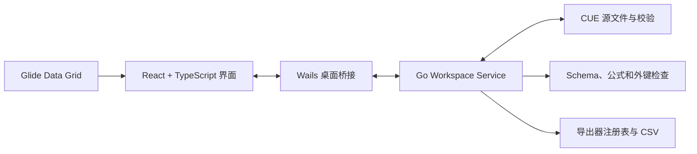

# Datapack Editor

[English](README.md)

Datapack 是一个用于维护结构化游戏数据的桌面编辑器。它将接近电子表格的编辑体验与 CUE Schema、数据校验、引用关系、公式以及适合 Git 管理的文本源文件结合起来。

它希望替代“Excel 配表、手工导表脚本和多份数据副本”组成的割裂工作流。策划可以在熟悉的表格界面中编辑数据，同时把数据结构、填写约束、表间关系和导出设置保存在同一个数据工程中。

## 可以用 Datapack 做什么

- 创建、打开和另存为 `.dtproj` 数据工程。
- 使用逻辑 namespace 组织相互关联的数据表。
- 编辑字符串、整数、数字、布尔、枚举、数组和扁平结构体。
- 定义工程内共享的公共 Schema 和仅供单表使用的本地 Schema。
- 为列配置类型、默认值、范围、格式、枚举和可复用约束。
- 使用标量外键或数组外键连接不同数据表。
- 从外键、公式和 Schema 引用跳转到目标位置。
- 使用同行公式和同表跨行公式。
- 为单个单元格添加评论。
- 在对应单元格查看编译、Schema、公式和外键诊断。
- 安全地重命名被引用的行、表、列和 Schema 定义。
- 对源文件编辑执行 Undo/Redo。
- 配置项目级和表级 CSV 导出。
- 切换自动/手动编译、中英文界面以及浅色/深色主题。

典型用途包括道具、角色、技能、效果、怪物、掉落、任务、经济系统和数值成长配置。如果一套数据需要经过 Git 审查、在发布前完成校验，并且需要保持多表引用一致，Datapack 会比普通电子表格更适合。

## 当前版本边界

这是第一个可用版本，范围有意保持明确和克制：

- Datapack 只编辑自身定义的受限 CUE 工程格式，不是通用 CUE 编辑器。
- 当前内置导出格式为 CSV。
- 公式可以引用当前行和同一逻辑表的其他行，不能跨表查询任意字段。
- 外键用于校验和导航，不提供 join 或电子表格查找函数。
- 数组和结构体必须保持扁平，表格编辑器不支持任意深度嵌套数据。
- 当前没有安装器、自动更新或操作系统文件关联。
- 当前二进制构建主要在 Linux 桌面环境中验证。

## 运行二进制程序

Datapack 目前以独立可执行文件发布，不需要安装器。可以把二进制文件放在任意允许执行程序的位置。

Linux：

```bash
chmod +x datapack
./datapack
```

Linux 版本需要系统提供 GTK 3 和 WebKitGTK 4.1 运行库，具体软件包名称取决于所用发行版。

Datapack 工程是由用户自行选择位置的普通目录，与程序二进制所在目录无关。用户级设置和日志保存在操作系统的用户配置目录中。Linux 默认位置为：

```text
~/.config/datapack/
```

## 快速开始

1. 启动 `datapack` 可执行文件。
2. 选择“文件 > 新建工程”，或打开已有 `.dtproj` 文件。
3. 从工程树打开一张表或一个 Schema。
4. 在表格中编辑数据，并处理编辑器显示的诊断。
5. 配置项目导出表选择和表级导出列。
6. 编译工程，然后执行导出。
7. 从工程配置的 `exports/` 目录读取生成的 CSV 文件。

要查看完整示例工程，请打开：

```text
docs/examples/skyharbor-content/skyharbor-content.dtproj
```

## 教程

Skyharbor 学习工程演示了完整编辑流程，包括公共和本地 Schema、约束、数组、结构体、外键、公式、评论、诊断、导航、编译、导出以及 Undo/Redo。

- [Skyharbor 中文教程](docs/examples/skyharbor-content/README_zh.md)
- [Skyharbor English Tutorial](docs/examples/skyharbor-content/README.md)

## Datapack 与 Excel 有什么不同

Excel 和类似的电子表格工具把工作簿视为一个灵活网格。单元格几乎可以包含任意内容，数据结构通常依赖团队约定、公式、数据验证规则或外部脚本表达。这种灵活性很适合分析，但当数据成为正式生产资产后，大规模校验、引用维护和安全重构会变得困难。

Datapack 从不同的模型出发：

- 一个工程包含有明确名称的表、共享规则、表间关系和导出配置。
- 每张表都有声明过的行结构，每一行都必须通过该结构的校验。
- 一列是一个有类型的字段，而不是一组彼此无关的任意单元格。
- 数组和结构体作为一个完整的强类型值保存在单元格中，而不是临时拆成若干列。
- 外键是显式的工程关系，因此可以进行存在性校验、跳转、同步重命名和删除保护。
- 公式结果是派生的预览值和导出值，不会被静默复制到源数据行中。
- 源文件是适合版本管理的格式化文本；CSV 是生成物，不是正式可编辑数据源。

Datapack 使用表格界面，是因为网格非常适合批量编辑记录；但它的底层模型更接近一个小型的强类型数据库和构建系统：数据有明确契约，编辑操作具有结构语义，工程只有在校验通过后才能导出。

### 什么是 Schema

Schema 是描述“什么数据才是有效数据”的契约。它可以回答：

- 这个字段是字符串、整数、数字、布尔、枚举、数组还是结构体？
- 这个值是否允许为 null？
- 留空时应该使用什么默认值？
- 数字必须处于什么范围？
- 字符串是否必须符合命名格式或不能为空？
- 枚举允许哪些值？
- 一个结构体包含哪些成员？

每张表都有一个 `#Row` Schema，用于定义表中的列。Datapack 还支持两类可复用的命名 Schema：

- **公共 Schema** 可以在多张表之间共享，例如整个项目统一的游戏 ID 格式、稀有度枚举或非负约束。
- **本地 Schema** 只属于一张表，例如某张表专用的位置结构体或等级范围。

命名 Schema 又分为完整的 **type** 和可复用的 **constraint**。type 提供值的基础类型和结构，constraint 用于进一步限制一个兼容的已有类型。这个区分可以避免含糊的组合，也让编辑器能够提供结构化控件，而不是要求用户直接编写 CUE 表达式。

### 源表达式与显示值

一个单元格的源表达式和显示值有关联，但不一定完全相同。字符串在源文件中保存为合法 CUE 字符串表达式，表格中显示的是字符串正文；公式保存在 `_tool.formulas`，表格中显示的是计算结果；数组和结构体保存为有类型的 CUE 值，并通过专用控件编辑。

这也是为什么清空、粘贴、公式编辑和数据校验与普通无类型电子表格不同：编辑器维护的是合法源数据，而不是把所有单元格都当作普通文本。

## 设计思想

### 文本源文件是唯一可信来源

表的 `.cue` 文件是需要维护的正式数据源。它们可读、可审查，适合 Git diff 和多人合并。生成的 CSV 永远不会反向覆盖源表。

### 规则与数据放在一起

一张表的源文件通过明确分区保存不同职责：

- `#Row` 定义最终行结构和校验规则。
- `rows` 保存人工填写的固定值。
- `_tool` 保存表身份、外键和公式。
- `_editor` 保存显示信息和单元格评论。
- `_export` 保存导出格式和列配置。

### 保留表格效率，但不放弃类型安全

网格界面用于高效编辑记录，但所有写入都必须符合表的 Schema。无效数据会在对应表、行和列产生诊断，而不会静默进入导出结果。

### 重构必须保持引用安全

行、表、列和 Schema 定义会参与工程级关系。Datapack 在重命名时更新已知引用，在目标仍被使用时阻止删除。

### 导出是一次构建

自动编译提供快速反馈，手动编译适合集中编辑。无论当前使用哪种模式，导出前都会完整编译工程。即使某张表未被选择输出，它仍然参与校验。

详细设计和格式文档：

- [项目设计](docs/design.md)
- [`.dtproj` 格式](docs/dtproj-format-v1.md)
- [受限 CUE Schema 格式](docs/restricted-cue-schema-v1.md)
- [编辑器设置格式](docs/editor-settings-format-v1.md)

## 大致架构



- **React 和 TypeScript** 实现应用菜单、工程树、表格与 Schema 编辑器、设置和诊断界面。
- **Glide Data Grid** 提供高性能表格画布和单元格交互。
- **Wails** 承载桌面窗口，并把 Go 应用 API 暴露给前端。
- **Go workspace service** 负责工程生命周期、安全源文件编辑、Undo/Redo、编译状态、语义导航和导出编排。
- **CUE** 提供数据结构、约束、默认值、源文件格式化和最终值校验。
- **Schema、公式和外键服务** 建立工程级索引，并生成无法通过单个单元格校验表达的诊断。
- **导出器注册表** 发现可用格式，并将已通过校验的表交给目标导出器。CSV 是当前内置实现。

主要编辑流程为：

```text
用户编辑
  -> 安全修改 CUE AST
  -> 刷新工程树和语义索引
  -> 计算公式
  -> 校验 CUE、Schema 和外键
  -> 更新表格预览和诊断
  -> 导出前完整编译
  -> 生成 CSV
```

## 从源码构建

只有参与开发或无法取得预编译二进制时才需要从源码构建。

所需工具链：

- Go 1.25 或更新版本
- Wails CLI 2.13
- Node.js 20 或更新版本，以及 npm
- Linux 构建依赖：C 编译器、`pkg-config`、GTK 3 开发文件和 WebKitGTK 4.1 开发文件

CUE Go API 和其他 Go 依赖由 `go.mod` 固定版本；前端依赖由 npm lockfile 固定。

常用命令：

```bash
./scripts/dev.sh
./scripts/build.sh
go test ./...
npm --prefix frontend run typecheck
npm --prefix frontend run test:e2e
```

生产构建输出到：

```text
build/bin/datapack
```

Linux 构建脚本使用 Wails 的 `webkit2_41` build tag。

## 致谢

Datapack 基于以下开源项目构建：

- [CUE](https://cuelang.org/)：提供数据结构、约束和校验能力。
- [Wails](https://wails.io/)：提供结合 Go 与 Web 前端的桌面应用框架。
- [Go](https://go.dev/)：用于核心工程、源文件编辑、编译和导出服务。
- [React](https://react.dev/)：用于构建应用界面。
- [Glide Data Grid](https://grid.glideapps.com/)：提供高性能表格渲染与交互。
