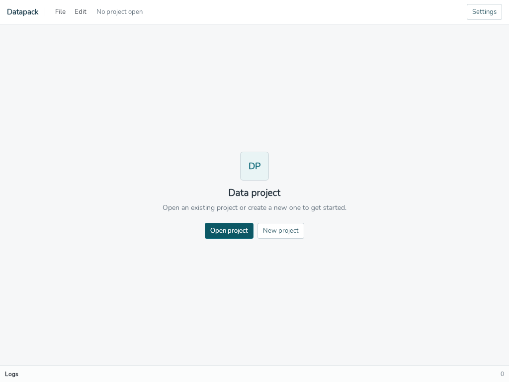

# 2026-11-01 质量维护实测证据

这里收录已经执行的原始输出与控制脚本，没有为补文档重新运行测试。SHA256 在 [SHA256.json](SHA256.json)。均为本机 Linux/amd64，Go 1.26.5；CPU 信息在 benchmark 输出中。

## 云岚基准

harness 为 `internal/workspace/quality_benchmark_test.go::BenchmarkYunlan`，fixture 为 `docs/examples/yunlan-rpg/yunlan-rpg.dtproj`。完整可复跑命令（仓库根目录、已有依赖）是：

```sh
GOTOOLCHAIN=local GOPROXY=off GOSUMDB=off GOFLAGS=-mod=readonly go test ./internal/workspace -run '^$' -bench '^BenchmarkYunlan$' -benchtime=3x -count=3 -benchmem
```

- [基线原始输出](benchmark-baseline.log) 的“02fe4f1基线”是生产代码的标签，不是声称该提交已有harness。可复跑的特征测试提交为 `7cc5ffc22e75964c38afc0bb362054b1ccb6945b`，父提交 `02fe4f144557671eb3738b4278901e17f708baa1`；两者只差2个测试文件、无生产代码差异。harness SHA256为 `35c0787c4989e06fa250637ffd1973430472aaef0e916f438d71896b6ef239c2`。
- 旧日志本身未包含运行HEAD或overlay记录，无法事后从该文本独立认证当时HEAD。因此只保留历史原始记录，不据此宣称严谨配对的前后性能比较。
- [组合原始输出](benchmark-integrated.log) 的实际运行代码为本地验证提交 `5300ebdc86fdbc4da85f217d2a777feb23b3b537`，完整tree `61f75d1e1d2a7072f9cb4e55b1e611e6fe74cac4`。公开正常合并提交 `ada0b8a2976a4d53fdf3f1b204406a24183379f5` 的tree与之完全相同，因此可以在后者复跑同一harness与fixture。当前harness与7cc5ffc中的字节哈希相同。
- 每个阶段3次独立基准、每次3迭代；原始输出同时保留ns/op、B/op和allocs/op。组合版scan约4.2–4.8ms、parse10.6–11.1ms、index0.049–0.058ms、compile189–192ms。没有统计显著性或跨机器推断，也不声称性能提升。完整CUE编译主导，本轮不引入缓存/增量/debounce。

## 实际原生 Wails smoke

使用同一组合提交5300ebdc的本地Linux Wails binary；代码tree与ada0b8a相同，binary校验值记录在SHA256.json。先完成产品及测试源码类型检查与Vite构建，原生构建命令为：

```sh
GOTOOLCHAIN=local GOPROXY=off GOSUMDB=off GOFLAGS=-mod=readonly ./scripts/build.sh -clean -s -m -nosyncgomod -skipbindings
bash docs/quality-evidence/native-startup-smoke.sh /absolute/path/to/own-evidence /absolute/path/to/build/bin/datapack
```

控制脚本是实际使用的 [native-startup-smoke.sh](native-startup-smoke.sh)，参数指定已存在的自有证据目录和binary。它创建临时XDG配置（manual/en/light），在隔离Xvfb/DBus会话启动app，捕获可见窗口；欢迎页实际显示英文，验证了真实GetSettings IPC。然后点击已视觉核验的Open project位置，等待真实GTK文件选择对话框可见，发送Escape，确认对话框消失，捕获回到欢迎页。脚本结束只终止自己启动的app，不打开真实工程，不改用户配置/安全设置，不使用sandbox绕过。

[已执行日志](native-smoke-redacted.log) 仅将DBus中绝对命令路径的comm字段脱敏；原日志和脱敏日志的哈希均记录。实际两条成功标记为 `native window and screenshot captured` 与 `native file dialog opened and Escape cancellation captured`。DBus服务启动信息不是通过条件；通过依据是实际窗口/对话框状态与截图。首次控制器曾在已销毁dialog的keyup报BadWindow；改用正常焦点Escape并验证关闭后，该正式记录成功，不隐去先前试验边界。

取消后的实际截图（无工程或文件目录内容）：



此smoke只证明窗口、设置IPC、原生选择/取消的这条链路；不证明桌面表格编辑、系统剪贴板、保存对话框或全部Wails序列化。浏览器回归仍mock IPC，真实源文件/编译/导出/历史由Go测试覆盖。
